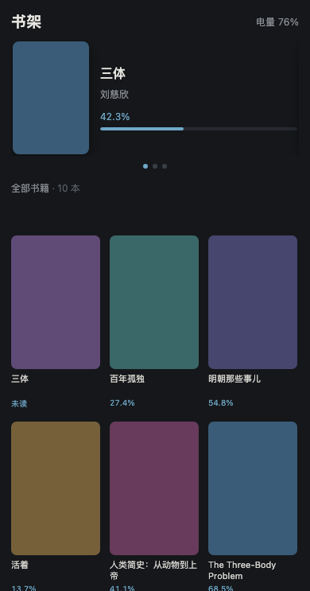

# kremote.koplugin

用手机浏览器遥控 [KOReader](https://github.com/koreader/koreader) 的插件：在 Kindle 上起一个极简 HTTP 服务，手机连同一个 Wi-Fi，打开网页先看到书库，点一本书 Kindle 就跳到那本书；进去以后翻页、切章节、调字号、调前光、切夜间模式，并实时看到书名、页码、百分比和电量。

不碰蓝牙、不碰内核、不需要 root，只用一个 Lua 写的非阻塞 HTTP 服务。

| 书架页 | 控制页 |
|---|---|
|  |  |

## 为什么不是蓝牙

Kindle 的蓝牙栈只注册了 A2DP/HFP 音频 profile，没有 SPP 串口服务，也没有 BLE GATT server。要收自定义指令就得自己搬一套蓝牙协议栈接管系统蓝牙（约 20MB，且有变砖风险）。相比之下 Wi-Fi 方案零风险，还能双向通信——手机能读回 Kindle 的状态，这是单向蓝牙信号做不到的。

没有路由器也没关系：手机开热点、Kindle 连热点，就是一个私有局域网。

## 功能

**已实现**

| 分组 | 能力 |
|---|---|
| 书架 | 最近阅读 3 本做成轮播，全部书两行横向滑动，只显示封面、书名、进度 |
| 选书 | 点封面 → Kindle 打开这本书，手机进控制页；点左上角返回 → 两边一起回书架 |
| 跟随 | 手机按 Kindle 的实际状态决定显示哪一页；你在 Kindle 上手动开书/关书，网页会跟着切 |
| 翻页 | 上一页 / 下一页（EPUB 和 PDF 都有效） |
| 章节 | 上一章 / 下一章 |
| 排版 | 字号 + / − |
| 显示 | 夜间模式、强制全刷 |
| 前光 | 0–24 档亮度滑杆，支持左右步进键 |
| 状态 | 书名、作者、当前页/总页、百分比、电量、充电态、亮度档位，每 2 秒自动刷新 |
| 系统 | 重启 KOReader、退出 KOReader |
| 菜单 | 启动/停止服务、显示访问地址、开机自动启动 |

> 装了「觅阅」（MiuRead）这类带自己桌面的定制版时，手机点返回会让 Kindle 回到**觅阅桌面**，而不是 KOReader 的文件浏览器——返回动作走的是觅阅自己的 `return_to_miuread_home()`，它负责关文档、重建底下的 FileManager、再把桌面抬回来。原版 KOReader 没有这层桌面，返回的仍然是文件管理器。

**做不到的**

- **音量、朗读**：设备没有扬声器（能读到音频设备不代表能发声）
- **实时屏幕镜像**：e-ink 每次全刷 1 秒以上，当第二块显示器不现实
- **依赖屏幕坐标的操作**：选中文字、手写批注、点具体某个菜单按钮。这类操作本质是"在某个像素位置点一下"，坐标随排版和字体会变，没法可靠映射
- **没有内置封面的书**：占位方块显示书名首字。封面来自 KOReader 的 CoverBrowser 缓存，它没抽过的书，第一次请求会现场抽（几秒），之后落盘缓存

## 兼容性

在 **Kindle Basic 3（代号 rex，固件 5.18.1.1.1，KOReader v2026.07.1）** 上开发和实测。

需要：

- KOReader 自带 LuaSocket（官方发行版都有，`common/socket.lua` + `common/socket/`）
- 没有前光的机型也能用，只是亮度那一行会自动隐藏

## 安装

**方式一：下载打包好的 zip**（推荐）

到 [Releases](../../releases) 下载最新的 `kremote.koplugin.zip`，解压出的 `kremote.koplugin` 文件夹整个放进 KOReader 的 `plugins/` 目录，重启 KOReader。

**方式二：git clone**

把整个目录放到 KOReader 的 `plugins/` 下，目录名必须保持 `kremote.koplugin`：

```bash
# 方式一：直接在设备上 clone（需先在 KOReader 里启动 SSH 或终端）
cd /mnt/us/koreader/plugins
git clone https://github.com/FightingJoey/kremote.koplugin.git

# 方式二：电脑上下载后拷贝（USB 或 scp）
scp -r kremote.koplugin root@<kindle-ip>:/mnt/us/koreader/plugins/
```

放好之后**重启 KOReader**（插件只在启动时加载），然后打开一本书，进菜单 **工具 → 手机遥控 → 启动遥控服务**，屏幕上会显示访问地址。

建议顺手勾上「打开 KOReader 时自动启动」。

> **macOS 用户注意**：用 Finder 拖拽到 Kindle（FAT32）会生成 `._*` 和 `.__*` 的 AppleDouble 文件。这些文件会让某些插件加载失败，装完记得在设备上清理：`find /mnt/us/koreader/plugins/kremote.koplugin -name "._*" -delete`。

## 使用

手机连同一个 Wi-Fi，浏览器打开 `http://<Kindle的IP>:18080`。

**重要：Kindle 的 `iptables` INPUT 默认策略是 `DROP`**，出厂只放行 SSH 的 2222 端口。所以任何新端口的服务即使正常监听，外部也连不上——本机 `127.0.0.1` 却完全正常，非常容易误判成"插件没加载"。

插件会在启动服务时自动补一条放行规则（幂等，已有则跳过）：

```bash
iptables -I INPUT 1 -i wlan0 -p tcp --dport 18080 -m conntrack --ctstate NEW -j ACCEPT
```

停止服务时只删除**自己加的**那条，不会误删别的规则。Kindle 重启或 Wi-Fi 重连后规则可能被系统重刷，插件会在 KOReader 唤醒时再补一次。

## HTTP API

面板就是用这些接口拼出来的，你也可以自己写脚本或快捷指令调用。

| 方法 | 路径 | 说明 |
|---|---|---|
| GET | `/` | 手机端页面（HTML，书架页或控制页由 `/api/state` 决定） |
| GET | `/api/state` | 轻量状态：当前在书架还是阅读、电量（书架页轮询用） |
| GET | `/api/shelf` | 书库 JSON：`recent` 最近 3 本 + `books` 全部，`?r=1` 强制重扫 |
| GET | `/api/cover?h=<hash>` | 书籍封面 JPEG/PNG，按文件 mtime 落盘缓存，带一天浏览器缓存头 |
| GET | `/api/open?h=<hash>` | 在 Kindle 上打开这本书（返回后延时 0.35s 才真开，避免手机端等到超时） |
| GET | `/api/home` | 关掉当前文档退回书架 |
| GET | `/api/status` | 当前状态 JSON |
| GET | `/api/next` | 下一页 |
| GET | `/api/prev` | 上一页 |
| GET | `/api/chapter_next` | 下一章 |
| GET | `/api/chapter_prev` | 上一章 |
| GET | `/api/font_inc` | 字号 +1 |
| GET | `/api/font_dec` | 字号 −1 |
| GET | `/api/night` | 切换夜间模式 |
| GET | `/api/refresh` | 强制全刷 |
| GET | `/api/light?n=12` | 设置前光档位（0–24，超范围自动夹取） |
| GET | `/api/restart` | 重启 KOReader |
| GET | `/api/quit` | 退出 KOReader |

`/api/shelf` 返回示例（`h` 是路径哈希，`t` 书名，`a` 作者，`p` 百分比，`c` 是否有封面）：

```json
{"ok":1,"view":"shelf","battery":76,"charging":0,
 "recent":[{"h":"aaa00001","t":"三体","a":"刘慈欣","p":42.3,"c":1}],
 "books":[{"h":"bbb00000","t":"三体","a":"刘慈欣","p":0,"c":1}]}
```

`/api/status` 返回示例：

```json
{"ok":1,"view":"reader","title":"书名","authors":"作者","page":2358,"pages":6935,
 "percent":34.0,"battery":49,"charging":0,"night":0,"light":12,"lightmax":24}
```

**状态码**：`200` 成功；`404` 未知路径，或 `h` 解析不到书；`409` 该动作需要先打开一本书（书架上点翻页会走到这里）；`500` 动作执行出错，响应体带 `error` 字段。

退出码：动作用 `200` 表示"已派发"，不代表 UI 已经完成渲染。

## 实现要点

- **非阻塞 HTTP**：`httpcore.lua` 自己实现的最小 HTTP/1.1 解析器，`accept`/`recv` 全部非阻塞，由 `UIManager:scheduleIn(0.15, ...)` 驱动，不占 UI 线程。参考了 KOReader 自带的 `simpletcpserver.lua` 的做法。发大响应（封面图）时按已发送长度循环推进，避免 `send` 只发出一部分就关连接。
- **书库数据从哪来**：最近阅读直接读 `$DataDir/history.lua`，不依赖 `ReadHistory` 单例是否已经加载；进度先问 `BookList.getBookInfo`（和文件管理器列表缓存同源），再退到 `DocSettings`；书名作者走 CoverBrowser 的 `bookinfo_cache.sqlite3`。整表扫描结果缓存 60 秒。
- **封面为什么不自己抽**：每本书现场 `openDocument` 抽封面要几百毫秒到几秒，几十本一起抽能把 Kindle 卡死。CoverBrowser 早就把封面缩略图 zstd 压缩存进它自己的 SQLite 了，这里只做"解压 → 缩到 260px 宽 → JPEG 编码"，落盘到 `settings/kremote_covers/<hash>.jpg`，按书文件 mtime 判失效。列表里只读元数据，不解封面 BLOB。
- **两个页面怎么切**：`/api/status` 的 `view` 由"当前有没有打开的文档"算出来，网页按 Kindle 的真实状态决定显示哪一页；控制页每 2 秒、书架页每 4 秒轮询一次，所以你在 Kindle 上手动开书关书，手机那边会自己跟上。
- **打开书籍延时执行**：`openDocument` 会阻塞一两秒（解析文件、建立排版）。所以 `/api/open` 只做存在性检查，然后 `UIManager:scheduleIn(0.35, ...)` 派发，等 HTTP 响应发完再切书，否则手机端看到的是连接被重置。
- **翻页**走 `GotoViewRel` 事件，和官方自动翻页插件 `autoturn` 用的是同一行调用，`ReaderRolling` 和 `ReaderPaging` 都实现了它，所以 EPUB 和 PDF 通用。
- **亮度**走 `Device:getPowerDevice():setIntensity(n)`，不直接写 `/sys/class/backlight`。直接写 sysfs 会让 KOReader 记录的档位和硬件实际值脱节，下次它恢复亮度时会把你的设置覆盖掉。
- **常驻插件**：没有设 `is_doc_only = true`，所以书架和阅读界面各会加载一份实例。两份实例通过模块级的 `SERVER` 表共享同一个服务，避免重复 `bind` 端口。动作按"当前是否有打开的文档"派发。
- **不干预自动休眠**：不设置 `PluginShare.pause_auto_suspend`。Kindle 按自己的 30 分钟超时休眠，省电。但手机发来的**动作**（翻页、调亮度等）会计为一次用户操作，重置 AutoSuspend 的计时——否则你正用手机连续翻页，手指没碰屏幕，设备会中途睡过去。**纯 `/api/status` 轮询不算**，所以放下手机 30 分钟照样休眠。
- **重启**直接走 `UIManager:restartKOReader()`，也就是退出码 85。`koreader.sh` 里有 `while [ $RETURN_VALUE -eq 85 ]` 循环，
  会原地重新拉起 `reader.lua`，同时框架保持停止、插件全部重新加载。
  早先试过"退出再用 `kpm launch --asap` 从外部拉起"，在 Kindle 上不可靠：`reader.lua` 一退出 `koreader.sh` 就结束、
  Amazon 框架随即恢复，这时再启动 KOReader 等于跑在框架底下，会被抢焦点甚至直接收掉。

## 测试

`tests/` 下是开发时用的设备端验证脚本，需要拷贝到设备上，用 KOReader 自带的 luajit 跑：

```bash
# HTTP 层：状态码、Content-Length、连续请求不粘包
/mnt/us/koreader/luajit tests/test_httpcore.lua

# 插件链路：mock 掉 KOReader 的 UI 层，验证状态采集、路由分派、事件名
/mnt/us/koreader/luajit tests/test_plugin.lua

# IP 探测
/mnt/us/koreader/luajit tests/test_ip.lua
```

裸跑 `luajit` 没有 KOReader 的 `package.path`，所以脚本开头要 `require("setupkoenv")`。

电脑侧还有两个不用设备的工具：

```bash
# 本地预览：直接读 panel.html，假书库 + 假封面，改完刷新浏览器
python3 tests/preview_server.py          # http://127.0.0.1:8099
                                         # /?view=reader 看控制页

# HTTP 层：用假 socket 顶替 LuaSocket，重点验证大响应分片发送、HEAD、404/500
python3 tests/test_httpcore_mock.py

# 书库逻辑：用 lupa 起一个 Lua 运行时，mock 掉 KOReader 模块，
# 验证目录扫描、进度读取、封面缩放/编码/磁盘缓存
python3 tests/mock_shelf.py
```

三个脚本都只依赖 `pip3 install lupa pillow`，不需要 Kindle，也不需要 Lua。

## 已知限制

- **Kindle 商店的 `.azw/.azw3` 取不到封面**。DRM 保护的文件解不出封面页，书架里这些书显示书名首字占位，其余照常可用。
- **封面质量**：优先用 CoverBrowser 已经缩好的缓存；缓存里的图太小时（实测有些只有 47×62，手机上会糊）会现场开文档抽一次原图，
  再缩到 260px 宽存成 JPEG。所以第一次翻到某本书时可能要等一两秒，之后走磁盘缓存，几十毫秒。
- **无鉴权**。同一 Wi-Fi 下任何人知道 IP 就能翻你的书。自己家里用没问题，公共网络下建议改成手动启动而不是自动启动。要加 token 鉴权的话，改动很小。
- **休眠后连不上**。Kindle 休眠会断 Wi-Fi，碰一下设备唤醒即可，服务会跟着进程一起回来（`onResume` 会补防火墙规则）。这条路径在真实休眠/唤醒循环下的表现还没做过严格验证。
- **只覆盖 KOReader**。原生阅读器界面不归它管。

## 卸载

删掉整个 `kremote.koplugin` 目录，重启 KOReader。插件不写系统文件、不改配置，删完就干净了（`settings.reader.lua` 里可能留下一个 `kremote_auto` 键，无副作用）。

## License

[MIT](LICENSE)
